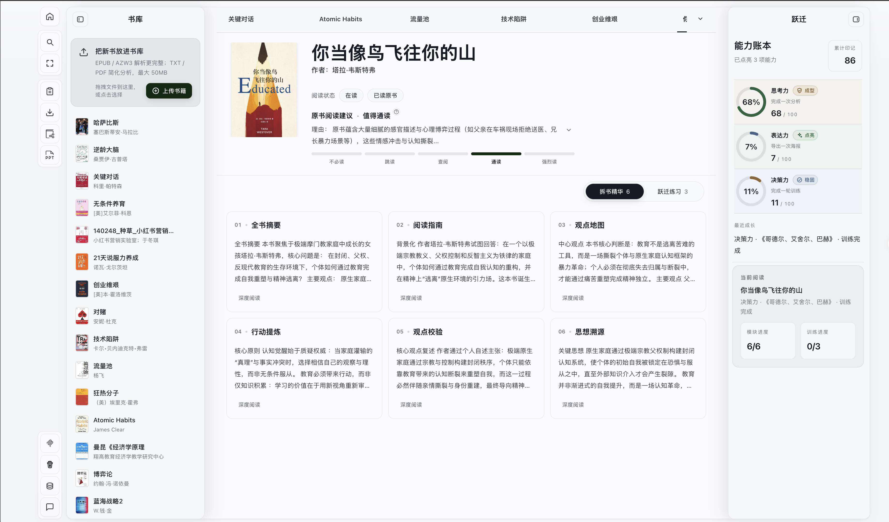
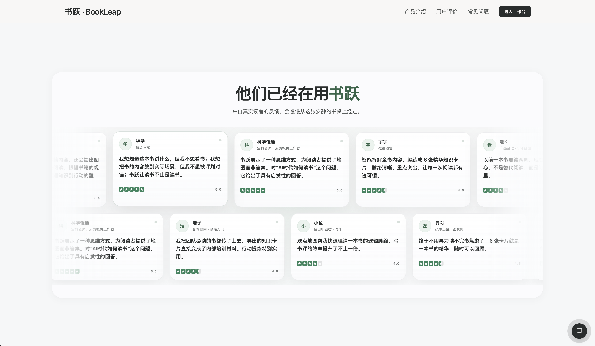

<div align="center">

# 📖 Bookleap · 书跃

### Turn a good book into a clearer decision.

An AI reading workspace for structured insights, practical exercises, and a library your own agent can query.

**English** · [简体中文](README.zh-CN.md)

[](https://github.com/Richology/Bookleap/stargazers)
[](LICENSE)
[](package.json)
[](tsconfig.json)
[](#connect-your-agent)

**[Website](https://www.bookleap.cn) · [Try the Workspace](https://www.bookleap.cn/workspace) · [Download Sync Assistant](docs/local-mcp/DOWNLOADS.md) · [Self-host](#self-host)**

⭐ *Help more readers discover Bookleap. Star this repo!*

[](docs/images/workspace.png)

*A real reading workspace. Your books, insights, and practice in one place.*

</div>

[Features](#from-reading-to-understanding) · [Get started](#start-with-one-book) · [MCP](#connect-your-agent) · [Self-host](#self-host) · [Data & privacy](#your-library-and-your-data) · [Contribute](#contribute)

## From reading to understanding

Bookleap helps you decide what deserves a closer read, see how a book's arguments fit together, and put its ideas to work. Built primarily for Chinese readers, it brings analysis, evidence, practice, and export into a desktop-first workspace. The current interface and generated reading experience are primarily in Chinese.

### One book. Six ways to understand it.

Upload an **EPUB, PDF, AZW3, or TXT** file, up to **50 MB**, and explore:

| Reading card | What it helps you do |
| --- | --- |
| **Book summary** | Understand the main question, argument, and conclusions. |
| **Reading guide** | Decide where to start and what deserves your attention. |
| **Argument map** | Follow the structure and connections between ideas. |
| **Action extraction** | Turn useful ideas into things you can try. |
| **Critical review** | Examine assumptions, limits, and competing views. |
| **Intellectual origins** | Explore the ideas and traditions behind the book. |

EPUB and AZW3 support fuller structured analysis; PDF and TXT use a simplified analysis path. AI-generated interpretations should be checked against the original book.

### Keep reading. Put ideas to work.

- **Read at your own pace.** Switch between overview cards, immersive reading, and available source evidence. Save highlights and excerpts.
- **Practice decisions.** Work through reading-based exercises and track thinking, expression, and decision-making progress.
- **Make something worth keeping.** Export Markdown, TXT, JSON, Obsidian or Notion packages; create quote posters and interactive book presentations.
- **Build a reusable library.** Revisit past analyses, search your books, and optionally connect saved content to your agent through local MCP.

## Start with one book

**[Open the workspace →](https://www.bookleap.cn/workspace)** No account is required.

1. Choose a built-in sample book to explore prepared content, or upload your own ebook.
2. Open an analysis card, inspect available evidence, and save what matters.
3. Try an exercise or export your reading notes. Return to the same browser to revisit your library.

[](https://www.bookleap.cn)

*Visit [bookleap.cn](https://www.bookleap.cn) to explore the product, or [go straight to your workspace](https://www.bookleap.cn/workspace).*

### A reading desk, with a library behind it

The homepage opens with a wall of books. Inside the workspace, each book becomes something you can return to: its arguments, your highlights, and the ideas you want to practice.

[](docs/images/book-wall.png)

*The book wall is a visual introduction; it is not a downloadable collection of ebooks.*

## Reader feedback

Readers use Bookleap to prepare book reviews, revisit ideas, and bring reading into their work. Here is the feedback section from the website.

[](docs/images/testimonials.png)

## Connect your agent

The optional **Bookleap Local Sync Assistant** (installed as **书跃本地同步助手**) saves authorized analyses to a folder on your computer. A separate, read-only MCP server lets your agent list books, search saved content, and retrieve analyses and available evidence.

**Bookleap web workspace → Local Sync Assistant → Local library → Your MCP-compatible agent**

| Trial download | Platform |
| --- | --- |
| [Download for Mac](https://github.com/Richology/bookleap-downloads/releases/download/v0.1.0-trial.1/bookleap-sync-0.1.0-trial.1-mac-arm64.dmg) | Apple Silicon / M-series |
| [Download for Windows](https://github.com/Richology/bookleap-downloads/releases/download/v0.1.0-trial.1/bookleap-sync-0.1.0-trial.1-win-x64.exe) | x64 |

1. Install the assistant and choose your local library folder.
2. In **Chrome**, open **本地 MCP** in the workspace, enter the pairing code, and confirm the source in the assistant.
3. Use **连接 Agent** in the assistant to configure a client that supports local stdio MCP. Ask it: “What books are in my library?”

Keep the webpage and assistant running to sync new content. **Closing the assistant window keeps it running in the background; quitting stops new syncs.** Previously saved content remains queryable through the independently launched MCP server. Reopen both to sync pending changes.

> **Preview:** These are unsigned trial installers, with automatic updates disabled. Chrome is the current trial browser; Safari, other browsers, and Intel Mac are not validated for this release. End-to-end acceptance with real libraries and different agent clients is still in progress. Built-in configuration assistance is currently Codex-specific; other clients use manual MCP settings.

See [installation and pairing instructions](docs/local-mcp/DOWNLOADS.md), [MCP tools and development notes](docs/local-mcp/README.md), and [validation status](docs/local-mcp/bridge-validation.md). These detailed guides are currently in Chinese.

## Self-host

Requires **Node.js 20.9+** and **npm**. Use a supported Node.js LTS release that meets this minimum.

```bash
git clone https://github.com/Richology/Bookleap.git
cd Bookleap
npm ci
```

Create `.env.local` in the project root:

```dotenv
DEEPSEEK_API_KEY=your_deepseek_api_key
# Optional; this is the default endpoint.
DEEPSEEK_BASE_URL=https://api.deepseek.com
```

Then start the app:

```bash
npm run dev
```

Open [localhost:3000](http://localhost:3000) or [the local workspace](http://localhost:3000/workspace).

<details>
<summary><strong>Use Ollama instead of DeepSeek</strong></summary>

Leave `DEEPSEEK_API_KEY` unset. Install Ollama on the machine running the app, then run:

```bash
ollama pull qwen2.5:3b
ollama serve
```

If Ollama is already serving, you only need to pull the model. The app uses `http://127.0.0.1:11434` and `qwen2.5:3b` when no DeepSeek key is configured.

</details>

<details>
<summary><strong>Production and developer checks</strong></summary>

```bash
npm run lint
node --test lib/*.test.mjs lib/**/*.test.mjs
npm run build
npm start
```

Production uploads use Vercel Blob; configure its credentials through the Vercel Blob integration. Keep API keys and Blob tokens on the server.

The optional desktop assistant is a separate npm project:

```bash
npm ci --prefix local-mcp
npm test --prefix local-mcp
```

See the [engineering guide](AGENTS.md) for architecture and development conventions, and the [assistant guide](docs/local-mcp/README.md) for desktop builds.

</details>

**Built with:** Next.js 16 · React 19 · TypeScript · Tailwind CSS 4 · DeepSeek / Ollama · IndexedDB · Vercel Blob. The optional desktop assistant uses Electron and MCP.

## Your library and your data

- **Browser storage:** Your library and reading records live in IndexedDB and localStorage. There is no account-based cloud library sync. Changing browsers, domains, or computers does not transfer them.
- **Backups:** Press `B` in the workspace to export a JSON backup, then import it in the new environment. Cloning this repository does not copy your library.
- **AI processing:** Uploaded books are processed by the app server; analysis context goes to the configured model provider. Local browser storage does not mean all processing stays on your device.
- **Agent access:** Local MCP reads the authorized local copy. Sample books are excluded by default; personal records require separate opt-in. If your agent uses a cloud model, retrieved excerpts may enter that model's context.

## Contribute

Bug reports, usability feedback, documentation improvements, and focused pull requests are welcome. [Open an issue](https://github.com/Richology/Bookleap/issues) with reproduction steps and your environment; use synthetic examples instead of private books or library backups.

Read the [product principles](PRODUCT.md) and [engineering guide](AGENTS.md) before changing core behavior. Please do not commit ebooks, credentials, or personal reading data. Contributions follow the project's license.

## License & acknowledgments

Original application code is licensed under **[GNU AGPL-3.0-only](LICENSE)**. Copyright © 2026 Bookleap contributors.

The book-presentation feature includes adapted Guizang templates; their license and attribution are retained. Other third-party software keeps its own licenses. See [third-party notices](THIRD_PARTY_NOTICES.md). Book covers, trademarks, quoted material, and uploaded books are not relicensed by this repository.

<div align="center">

**A good book is worth returning to.**

[Start reading with Bookleap](https://www.bookleap.cn/workspace) · [Give us a Star](https://github.com/Richology/Bookleap)

</div>
