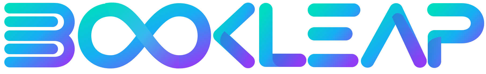
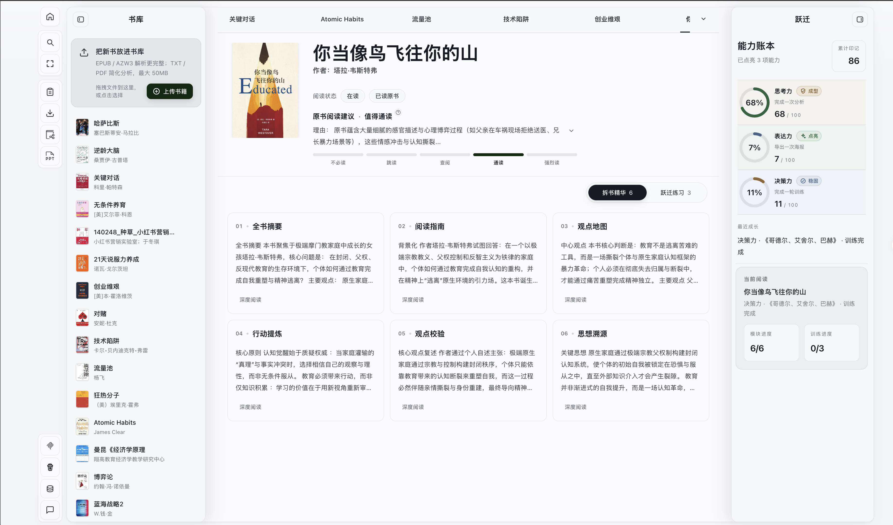
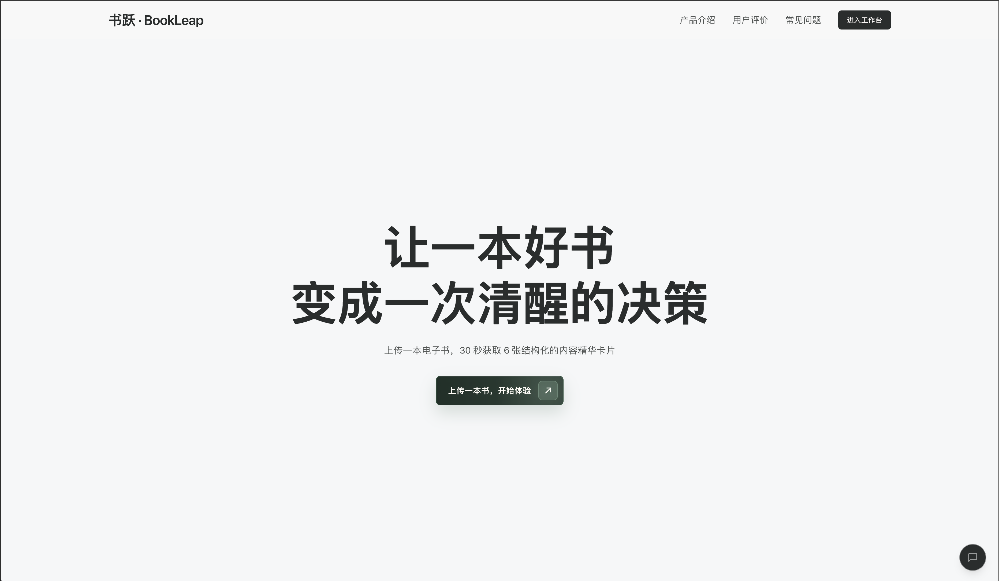
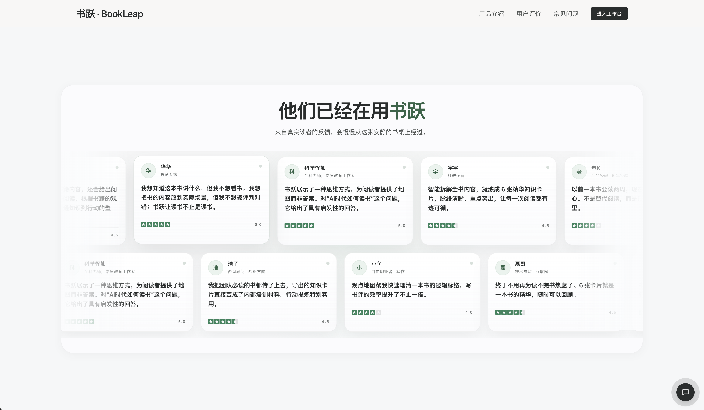

<div align="center">



# Bookleap · 书跃

### 让一本好书，变成一次清醒的决策。

用 AI 梳理一本书的观点，在练习中运用，让自己的 Agent 随时查询积累的书库。

[English](README.md) · **简体中文**

[](https://github.com/Richology/Bookleap/stargazers)
[](LICENSE)
[](package.json)
[](tsconfig.json)
[](#连接自己的-agent)

**[访问官网](https://www.bookleap.cn) · [打开工作台](https://www.bookleap.cn/workspace) · [下载同步助手](docs/local-mcp/DOWNLOADS.md) · [本地部署](#本地部署)**

⭐ *喜欢书跃？点个 Star，让更多读者发现它。*

[](docs/images/workspace.png)

*一张真实使用中的阅读书桌，放下你的书、思考和练习。*

</div>

[产品能力](#从读过到理解再到运用) · [开始使用](#从一本书开始) · [MCP](#连接自己的-agent) · [本地部署](#本地部署) · [数据与隐私](#你的书库与数据) · [参与贡献](#参与贡献)

## 从读过，到理解，再到运用

书跃帮助你判断一本书是否值得细读，看清观点之间的关系，并把有用的想法带进实际生活。它面向中文深度阅读者，将分析、证据回看、练习和导出放在同一个以桌面体验为主的工作台里。目前产品界面和阅读分析主要为中文。

### 一本书，六个理解角度

上传 **EPUB、PDF、AZW3 或 TXT**，单文件最大 **50 MB**，从六张卡片展开阅读：

| 分析卡片 | 帮你解决什么问题 |
| --- | --- |
| **全书摘要** | 这本书在回答什么问题？核心论点和结论是什么？ |
| **阅读指南** | 从哪里开始读？哪些地方值得投入时间？ |
| **观点地图** | 观点之间如何连接？整本书的逻辑是什么？ |
| **行动提炼** | 哪些想法可以变成自己尝试的行动？ |
| **观点校验** | 哪些假设需要审视？观点有什么局限或不同解释？ |
| **思想溯源** | 这些思想从哪里来？背后有什么脉络？ |

EPUB、AZW3 更适合完整结构化分析；PDF、TXT 使用简化分析流程。AI 生成的解读仍需结合原书判断。

### 继续读，也用起来

- **按自己的节奏阅读。** 在总览卡片、沉浸阅读和已有原文证据之间切换，保存高亮和书摘。
- **练习做判断。** 通过与阅读相关的情境练习，积累思考、表达和决策记录。
- **把内容留下来。** 导出 Markdown、TXT、JSON、Obsidian 或 Notion 内容包，制作书摘海报和交互式讲书演示。
- **让书库可以反复使用。** 回顾历史分析、搜索书籍，也可以通过本地 MCP 让自己的 Agent 查询已保存的内容。

## 从一本书开始

**[打开工作台 →](https://www.bookleap.cn/workspace)** 无需注册账号。

1. 选择内置体验书，直接浏览已准备好的内容；也可以上传自己的电子书。
2. 打开一张分析卡片，回看已有证据，留下值得记住的内容。
3. 完成一次练习，或导出阅读成果。下次使用同一个浏览器，即可回到自己的书库。

[](https://www.bookleap.cn)

*访问 [bookleap.cn](https://www.bookleap.cn) 了解产品，或[直接进入工作台](https://www.bookleap.cn/workspace)。*

### 一张书桌，背后是一座书库

首页从一面书墙开始。在工作台里，每本书都可以留下它的观点、你的高亮，以及你想继续练习的想法，等待下一次回看。

[](docs/images/book-wall.png)

*书墙是视觉展示，不是可下载的电子书合集。*

## 读者的反馈

准备书评、回顾观点、把阅读带进工作——下面是官网展示的读者反馈。

[](docs/images/testimonials.png)

## 连接自己的 Agent

可选安装的 **书跃本地同步助手** 会将已授权的拆书内容保存到电脑目录。独立的只读 MCP 服务让自己的 Agent 列出书籍、搜索已存内容、读取分析和已有证据。

**书跃网页 → 本地同步助手 → 本地书库 → 支持 MCP 的 Agent**

| 试用版下载 | 适用平台 |
| --- | --- |
| [下载 Mac 版](https://github.com/Richology/Bookleap/releases/download/v0.1.0-trial.2/bookleap-sync-0.1.0-trial.2-mac-arm64.dmg) | Apple Silicon / M 系列芯片 |
| [下载 Windows 版](https://github.com/Richology/Bookleap/releases/download/v0.1.0-trial.2/bookleap-sync-0.1.0-trial.2-win-x64.exe) | x64 |

1. 安装助手，选择本地书库目录。
2. 用 **Chrome** 打开工作台中的「本地 MCP」，填写配对码，并在助手中确认来源。
3. 在助手「连接 Agent」中配置支持本地 stdio MCP 的客户端，试着问：“我的书库有哪些书？”

同步新内容时，网页和助手都需要运行。**关闭助手窗口会继续后台运行；退出助手会停止新内容同步。** 已保存内容仍可通过独立启动的 MCP 查询；重新打开网页与助手后，会补同步尚未送达的变化。

> **试用范围：** 当前提供未签名安装包，自动更新已关闭。本轮以 Chrome 为试用浏览器，Safari、其他浏览器和 Intel Mac 尚未通过本轮验收。真实书库完整流程及不同 Agent 客户端的兼容性仍在验收中。现有自动配置入口针对 Codex，其他客户端需手动填写 MCP 参数。

详细步骤见[下载与配对说明](docs/local-mcp/DOWNLOADS.md)、[MCP 工具与开发文档](docs/local-mcp/README.md)及[验证记录](docs/local-mcp/bridge-validation.md)。

## 本地部署

需要 **Node.js 20.9+** 和 **npm**，请使用满足该要求且仍受支持的 Node.js LTS 版本。

```bash
git clone https://github.com/Richology/Bookleap.git
cd Bookleap
npm ci
```

在项目根目录创建 `.env.local`：

```dotenv
DEEPSEEK_API_KEY=your_deepseek_api_key
# 可选；以下为默认接口地址。
DEEPSEEK_BASE_URL=https://api.deepseek.com
```

启动应用：

```bash
npm run dev
```

打开 [localhost:3000](http://localhost:3000)，或[直接进入本地工作台](http://localhost:3000/workspace)。

<details>
<summary><strong>使用 Ollama 替代 DeepSeek</strong></summary>

不设置 `DEEPSEEK_API_KEY`，在运行应用的电脑上安装 Ollama，然后执行：

```bash
ollama pull qwen2.5:3b
ollama serve
```

如果 Ollama 已运行，只需拉取模型。未配置 DeepSeek Key 时，应用会使用 `http://127.0.0.1:11434` 上的 `qwen2.5:3b`。

</details>

<details>
<summary><strong>生产运行与开发检查</strong></summary>

```bash
npm run lint
node --test lib/*.test.mjs lib/**/*.test.mjs
npm run build
npm start
```

生产文件上传使用 Vercel Blob，需通过 Vercel Blob 集成配置凭据。API Key 和 Blob 私密令牌只应保存在服务端。

可选桌面助手为独立 npm 子项目：

```bash
npm ci --prefix local-mcp
npm test --prefix local-mcp
```

架构与开发约定见[工程指南](AGENTS.md)，桌面构建见[本地助手文档](docs/local-mcp/README.md)。

</details>

**技术栈：** Next.js 16 · React 19 · TypeScript · Tailwind CSS 4 · DeepSeek / Ollama · IndexedDB · Vercel Blob。可选桌面助手使用 Electron 与 MCP。

## 你的书库与数据

- **浏览器存储：** 书库和阅读记录保存在 IndexedDB、localStorage 中。目前没有基于账号的云端书库同步，换浏览器、域名或电脑不会自动带走数据。
- **备份迁移：** 在工作台按 `B` 导出 JSON 备份，再到新环境导入。克隆代码仓库不会复制你的书库。
- **AI 处理：** 上传的书籍会由应用服务端处理，分析上下文发送给配置的模型供应商。浏览器本地存储不代表整个处理过程都在本机完成。
- **Agent 访问：** 本地 MCP 读取已授权的本地副本。体验书默认排除，个人记录需单独授权；Agent 使用云模型时，检索出的片段可能进入模型上下文。

## 参与贡献

欢迎问题反馈、使用体验、文档改进和聚焦具体问题的 PR。[提交 Issue](https://github.com/Richology/Bookleap/issues) 时，请附复现步骤与使用环境，用合成示例代替私人书籍或书库备份。

修改核心功能前，请阅读[产品原则](PRODUCT.md)和[工程指南](AGENTS.md)。不要提交电子书原文件、凭据或私人阅读数据。贡献代码遵循项目许可。

## 开源协议与致谢

原创应用代码采用 **[GNU AGPL-3.0-only](LICENSE)**。Copyright © 2026 Bookleap contributors。

讲书演示功能包含改编的归藏模板，保留上游许可和署名；其他第三方组件保留各自许可，详见[第三方声明](THIRD_PARTY_NOTICES.md)。书籍封面、商标、引用内容和用户上传的书籍，不因本项目开源而被重新许可。

<div align="center">

**一本好书，值得反复回来。**

[开始你的阅读](https://www.bookleap.cn/workspace) · [给书跃点个 Star](https://github.com/Richology/Bookleap)

</div>
