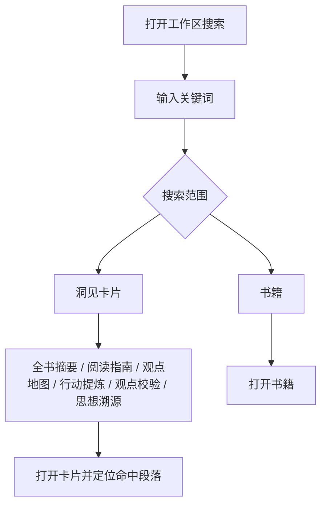

# 工作区搜索 v1 设计

日期：2026-07-19

## 背景

BookLeap 已经把一本书解析为可复用的阅读对象：书籍元信息，以及全书摘要、阅读指南、观点地图、行动提炼、观点校验、思想溯源等分析卡片。用户需要在多本已读书中重新找回一个概念、判断或行动建议。

当前的「书库搜索」已能搜索书名、作者、当前书卡片与历史书库卡片，但本质仍是关键词查找：结果排序按固定分组，点击后只进入卡片，且当前书的多关键词召回会受到展示摘录截断影响。

本次先把搜索做成可靠的“阅读洞见找回”工具，不在本阶段直接引入向量检索或模型问答。

## 问题定义

用户的目标不是“知道哪一本书存在”，而是快速回答：

> 我过去读过的书里，哪里谈过这个问题？我当时可以采用什么行动？

例如，用户搜索“复盘”“长期主义”“拖延”，应能看到匹配的书、分析卡片、命中上下文，并进入准确的命中位置。

## 目标

1. 搜索输入任何完整存量分析文本时都不会因结果摘要截断而漏召回。
2. 用户可按书籍、洞见卡片和卡片类型快速缩小结果。
3. 用户点击内容结果后，可直接看到命中的段落，而不只进入一整张长卡片。
4. 空书库与有书库时，按钮和快捷键行为一致、可理解。
5. 所有搜索在用户浏览器本地完成，不新增上传、模型调用或外部内容请求。

## 非目标

1. 不做原书全文搜索，也不恢复或永久保存整本原文。
2. 不做跨书自然语言问答、RAG、向量数据库或重新调用模型。
3. 不做公开搜索页、搜索结果 URL 分享或服务端账户同步。
4. 不改卡片生成链路及现有六张分析卡片的内容结构。
5. 不在本期引入复杂查询语法（如 `book:`、`author:`）。

## 现状与边界

### 当前可搜索数据

| 数据域 | 字段/内容 | 当前状态 |
| --- | --- | --- |
| 书库 | 书名、作者、文件类型、书籍状态 | 已支持 |
| 当前书 | 当前书的所有可见分析卡片 | 已支持 |
| 历史书库 | 六张分析卡片的保存内容 | 已支持 |
| 原书内容 | EPUB/PDF/TXT/AZW3 正文 | 明确不支持 |
| 外部图书目录 | Google Books / Open Library | 仅补封面、作者，不作为用户搜索 |

历史记录目前存于浏览器的 IndexedDB；v1 继续沿用本地优先的存储边界。

### 当前已知缺陷

1. 当前书先生成一个约 220 字的 excerpt，再用 excerpt 决定多词匹配。若两个关键词在同一卡片内但相距较远，该卡片会被错误过滤。
2. 所有书籍结果固定在内容结果之前，不能表达用户“找书”还是“找观点”的意图。
3. 点击内容结果只打开目标卡片，没有命中段落定位或高亮。
4. 无书可搜时，鼠标入口禁用，但 `K` 仍能打开空搜索框。
5. 搜索弹层没有说明当前数据范围，也没有可操作的空状态。

## 用户故事

### 1. 找一本曾读过的书

用户输入「原则」，首位出现书名精确匹配的结果。按 Enter 后打开该书，并回到阅读起点。

### 2. 找一个行动建议

用户输入「复盘」。结果默认优先显示包含该词的「行动提炼」和「观点校验」，每一项展示书名、卡片类型和命中上下文。用户选择一项后，直接进入对应卡片并看到命中词高亮。

### 3. 限定搜索范围

用户只想在「行动提炼」中找内容，点击筛选项后，其余卡片类型不再参与结果与计数。

### 4. 尚未建立书库

用户打开搜索时，看到可搜索范围的说明与「上传书籍」「打开赠送书单」两个明确的下一步，而不是一个无法使用的搜索框。

## 信息架构



## 交互设计

### 入口与快捷键

- 左侧工具栏保持「书库搜索」入口。
- 主快捷键改为 `⌘/Ctrl + K`；单独的 `K` 不再在全局触发，避免与正常键盘操作冲突。
- 有可搜索内容时，按钮可用。
- 无可搜索内容时，按钮仍可点击，打开“建立书库”空状态。快捷键与按钮统一进入同一状态。
- `Esc` 关闭搜索，`↑`/`↓` 选择结果，`Enter` 打开选中结果。

### 初始状态

打开且输入为空时显示：

1. 搜索范围提示：`搜索已保存的书名、作者与分析卡片，不搜索原书全文。`
2. 最近打开的 5 本书（若有）。
3. 当前书的 3 个可见卡片（若有）。
4. 可点击的示例词：`行动建议`、`长期主义`、`复盘`。示例词仅填入搜索框，不直接执行不可解释的操作。

### 查询状态

输入后显示一行筛选器：

`全部 · 书籍 · 洞见 · 全书摘要 · 阅读指南 · 观点地图 · 行动提炼 · 观点校验 · 思想溯源`

- 默认是「全部」。
- “洞见”包含所有六类卡片。
- 选择具体卡片类型后，仅检索该类型；书名、作者不出现在该结果中。
- 仅在当前有结果的类别显示数量，零结果类别不显示数量但仍可点击，避免筛选器跳动。

### 结果排序

结果不再按 UI 分组硬编码先后，而是先计算统一相关性，再按结果类别呈现。

优先级从高到低：

1. 书名精确匹配。
2. 书名或作者前缀匹配。
3. 卡片标题精确匹配。
4. 内容中连续短语匹配。
5. 内容中所有关键词均命中。
6. 同分时按最近阅读时间排序。

“全部”状态下保留视觉分组（书籍、洞见），但按各组最高相关性排序；若洞见最高分高于书籍，洞见组排在前面。筛选状态下只显示一个结果区，减少重复标题。

v1 为严格关键词检索：多关键词使用 AND 逻辑；不提供错别字、拼音、同义词或语义推断。

### 结果卡

书籍结果显示：书名、作者或文件信息、书籍来源标签。

洞见结果显示：

- 书名
- 卡片类型标签
- 命中段落的前后文摘录，最多 180 个字符
- 命中关键词高亮
- 有多个命中时显示 `共 N 处命中`

每个洞见结果只对应一张卡片和其中一个最佳命中段落；同一卡片不重复展示多个结果。

### 打开与定位

点击洞见结果后：

1. 打开目标历史书或保留当前书。
2. 进入沉浸卡片页，保持既有卡片切换动效。
3. 卡片渲染后滚动到最佳命中段落。
4. 对命中范围添加临时高亮，持续至用户离开该卡片、再次搜索或 8 秒后淡出。
5. 若该卡片有多个命中，在卡片头部显示 `1 / N 处命中` 与上/下一个按钮；按钮只在搜索跳转上下文存在时出现。

搜索结果中的历史内容若因旧数据缺失、付费/简化模式或卡片尚未生成而无法定位，仍打开该书与卡片，并显示一次轻量提示：`这条旧记录无法精确定位，已打开对应卡片。`

### 无结果与空书库

| 情形 | 文案 | 主要动作 |
| --- | --- | --- |
| 有书库，无匹配 | `没有找到“{query}”` | 清除筛选、清空关键词 |
| 没有任何可搜索内容 | `先把一本书放进书库，之后可在书名、作者和分析卡片中搜索。` | 上传书籍、打开赠送书单 |
| 有书但分析未完成 | `这本书仍在解析中，完成后可搜索分析卡片。` | 查看解析进度 |

## 数据模型与检索策略

### 搜索文档

搜索时为当前书与每本历史书生成内存搜索文档，不将额外的原书数据写入 IndexedDB。

```ts
type SearchDocument = {
  id: string;
  kind: "book" | "card";
  bookId: string;
  bookTitle: string;
  author: string;
  cardKey?: SearchCardKey;
  cardLabel?: string;
  rawContent?: string;
  lastOpenedAt: string;
};

type SearchMatch = {
  documentId: string;
  score: number;
  matchStart?: number;
  matchEnd?: number;
  matchCount: number;
  excerpt: string;
};
```

`rawContent` 只在当前页面内存中用于召回、排序和生成摘录，不以 excerpt 替代检索文本。

### 匹配规则

1. 统一做 Unicode 小写化、空白合并。
2. 若查询包含多个以空格分开的 token，所有 token 必须在同一搜索文档中命中。
3. 先尝试完整查询短语，获取连续短语的命中位置；否则使用最早 token 命中作为摘录中心。
4. `excerpt` 永远从 `rawContent` 的命中位置生成，不能参与是否命中的判断。
5. 仅返回每个搜索文档的最佳命中，默认上限 20 条。

### 性能约束

- 输入采用 120–180ms debounce。
- 不在键入过程中执行网络请求。
- 书库少于 100 本时，在主线程计算即可。
- 书库达到 100 本或累计卡片正文超过 2MB 时，将相同的索引和匹配函数移入 Web Worker。该阈值不是 v1 的阻塞项，但实现要保持纯函数，便于迁移。

## 可访问性

1. 搜索容器使用 `role="dialog"`、`aria-modal="true"` 与可读标题。
2. 打开后焦点进入输入框，关闭后回到打开搜索的工具按钮。
3. 焦点被限制在弹层内。
4. 活动结果使用 `aria-activedescendant` 或等价的可感知状态；不只依赖颜色框。
5. 结果计数、筛选变化和无结果使用适度的 `aria-live="polite"` 通知。

## 埋点与成功标准

本期不要求接入第三方分析平台，但应在可替换的本地事件层预留下列事件：

- `search_opened`
- `search_query_changed`（只记录长度和是否有结果，不记录关键词原文）
- `search_result_opened`（记录结果类型、卡片类型和排名）
- `search_empty`
- `search_filter_changed`

上线后用于判断的指标：

| 指标 | 初始目标 |
| --- | --- |
| 有结果查询的结果打开率 | ≥ 45% |
| 内容结果打开后 10 秒内未再次搜索的比例 | ≥ 60% |
| 搜索无结果率 | 首期只观测，不设硬阈值 |
| 已保存内容的多关键词漏召回 | 0 个回归用例 |

## 验收标准

### 功能

1. 当前书卡片中两个相距超过 220 字的关键词，同时搜索时仍能召回该卡片。
2. 搜索书名精确匹配时，书籍结果位于最高相关组。
3. 搜索概念且内容结果相关性最高时，洞见组位于书籍组之前。
4. 所有六类卡片均可单独筛选、搜索和跳转。
5. 历史书内容结果能打开正确书籍、正确卡片，并滚到最佳匹配段落。
6. 当前书内容结果不重新打开书籍，但同样定位命中段落。
7. 无书库时，点击按钮和按 `⌘/Ctrl + K` 均显示一致的建立书库状态。
8. `Esc`、方向键和 Enter 在搜索弹层中可用，不影响输入法正常输入。

### 回归与性能

1. 原有书名、作者、当前书和历史书搜索均继续工作。
2. 不新增任何外部网络请求或模型调用。
3. 20 本书、每书 6 张卡片的本地测试数据下，输入停止后 200ms 内出现结果。
4. 不改变现有“原文依据不做全文搜索”的产品边界。

## 实施拆分

1. 抽离纯搜索索引、匹配、排序与 excerpt 函数，先写单元测试覆盖多关键词漏召回。
2. 将工作区现有三段搜索计算切换至统一搜索文档与结果模型。
3. 更新搜索弹层：筛选器、初始态、空态、键盘与可访问性。
4. 为沉浸卡片添加搜索命中定位、高亮与多命中导航。
5. 完成功能回归、键盘测试与 20 本模拟书库性能检查。

## 后续候选，不纳入本期

### 搜索 v2：查询表达与容错

- `书:原则`、`作者:芒格`、`行动:复盘`
- 拼音、错别字与同义词扩展
- 保存搜索与个人主题集合

### 搜索 v3：跨书问答

新增“问书库”，针对开放问题生成跨书归纳。每项结论必须可点击回到书名、卡片类型与原文依据；不能让模型输出无法验证的总结。此功能需单独评估成本、隐私、检索质量和引用机制。

## 待确认决策

本 spec 默认采用下列决定，确认后即可进入实现：

1. v1 只做关键词搜索与精确定位，不做语义/RAG。
2. 主快捷键使用 `⌘/Ctrl + K`，移除裸 `K` 的全局触发。
3. 无书库时搜索入口保持可点击，并引导建立书库。
4. 结果筛选包含书籍、洞见和六种卡片类型。
5. 搜索关键词不发送到服务端，也不记录原文埋点。
