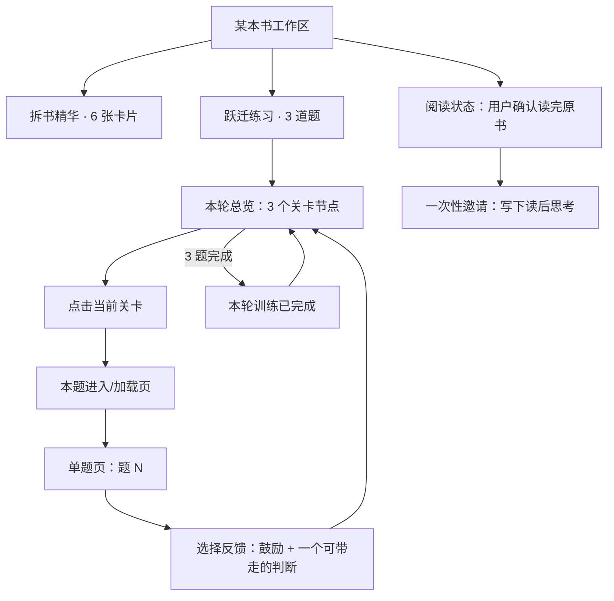

# 「跃迁练习」重构设计

日期：2026-07-20

## 一句话定义

「跃迁练习」是一本书完成拆解后的独立决策训练：系统把六张精华卡片转成一轮 3 题的渐进练习，用户在专属训练页按题作答、即时获得反馈，并以可见的进度回到题目总览。

它不是第七张精华卡片，也不是「读后记录」的后续表单。

## 背景与问题

当前实现把训练放在六张卡片的同一阅读流中，并在卡片下方固定放置「读后记录」。用户点击训练后，前端按顺序生成三道题；约 10 多秒的等待期间，除工具栏标题「生成中…」外没有明确反馈。生成结束后，训练面板直接插入卡片区域，因此用户一旦去读另一本文书或切换位置，题目会在不相关的上下文中突然出现。

当前答题页也承载了过多同级文本：场景、问题、两个选项、四段反馈都以线框卡片连续堆叠。信息层级、空间节奏和完成感不足，无法让人感到这是一次轻量但值得完成的训练。

截图中的「读后记录」进一步放大了这个问题：三列大文本框是一次高认知负担的表单，且把“留下想法”和“开始训练”强行绑在一次阅读结束上。它应成为用户在某本书内主动打开的私密记录入口，而不是六卡完成后的必经页。

## 目标

1. 让用户在任何时刻都能清楚知道题目是否正在准备、准备到哪一步、准备完成后去哪里做。
2. 将训练从阅读卡片流中解耦为独立页面/全屏路由；切书、返回阅读都不能造成题目突然出现在别处。
3. 让一轮训练有明确结构：题目总览 → 开始 → 单题作答 → 鼓励与总结 → 回到总览 → 下一题 → 完成 → 回到总览。
4. 通过轻量游戏化的进度、状态和即时肯定，促成完成 3 题；不使用积分轰炸、倒计时或人为施压。
5. 将「读后记录」从总览卡片下移除，改为书籍级、按需打开且独立保存的入口。
6. 保留现有本地优先、每本书缓存 3 题、完成后写入能力账本的边界。

## 非目标

1. 不把训练做成每日强制打卡、连续天数、排行榜或社交比较产品。
2. 不在本期增加账户同步、服务端保存用户答案或跨书混合题库。
3. 不改六张分析卡片的生成内容与完成条件。
4. 不要求用户先写读后记录才能开始练习。
5. 不在同一轮中改为多选、开放长答或自动评判正确/错误；仍为 A/B 的思考分岔与针对性反馈。

## 核心体验原则

### 训练与阅读分层

阅读负责吸收；训练负责调用。二者通过同一本书关联，但不共享同一主画布。用户从书中进入训练，也能随时返回书中；训练绝不在阅读列表中“长出来”。

### 准备过程必须可见、可离开、可找回

模型生成并不是瞬时操作。进入训练后立即给出一个有归属的三关地图；用户点击某一已解锁关卡时，才显示该关真实的加载、成功或失败状态。用户可离开，任务在同一本书的本地会话中继续；完成后只更新该书的关卡状态，绝不自动跳页或弹题。

### 每屏只服务一个决定

总览决定“练哪一题”，单题页决定“我会怎么选”，反馈页决定“我带走什么”。不把这三个决定堆到同一屏。

### 温和的成就感

训练的情绪目标是“我正在变得更会判断”，而不是“我答对了”。完成状态使用进度、绿色完成标记、小幅庆祝和具体鼓励；文案肯定观察与行动，不对选项判对错。

### Apple 风格的克制与直接性

界面以系统字体、留白、清晰的主次层级和少量可触感的材质建立信任。按钮按下即反馈；从入口进入训练与返回阅读遵循同一条空间路径；动效只解释层级切换和完成，不用装饰性循环动画。尊重 `prefers-reduced-motion`、高对比度和文字缩放。

## 出题 skill：用一本书训练三种人生复利

### 现状

当前出题 skill（`lib/prompts/decisionTraining.ts`）严格固定三类角色：

1. 职场执行者：工作中的执行、协作与反馈。
2. 个人成长者：生活、学习、习惯、情绪与长期成长。
3. 决策者：创业、管理、组织与长期方向。

这三类已覆盖“工作 / 生活 / 创业”，但它们只是**场景载体**，不是用户愿意练习的最终理由。当前 prompt 从“你是谁、在哪儿”开始，容易稳定产出一组看起来合理、实际上相似的 A/B 二选一；它没有先回答：这本书究竟帮助用户积累哪一种人生资本？

### 决策

**把出题 skill 的第一性目标改为三种人生复利：财富积累、健康增值、关系丰盈。工作 / 生活 / 创业与五类场景只是把目标落到真实处境中的载体。**

单轮固定为 **1 个当前人生课题 × 3 个判断阶段 = 3 关 / 3 道题**。因此不是三大课题各出三题的 9 题长测验。财富、健康、关系是三条可持续训练线：用户本轮只选一条（或由系统自动匹配一条），未来想继续时再主动开启另一条。一本书理论上最多可沉淀为 3 轮、9 道可选题，但首次体验永远只要求完成其中一轮的 3 题。

### 生成逻辑：从“人生课题”到“真实选择”

每道题都必须沿下列链条生成；缺任何一层都不能出题：


公式是：**好题 = 书中原则 × 人生复利 × 具体场景 × 不可兼得的代价。**

- 只有“工作冲突”没有人生复利，是职场案例，不是跃迁练习。
- 只有“财富 / 健康 / 关系”没有书中原则，是泛化鸡汤，不是拆书的价值。
- 两个选项可以同时做到，是建议题，不是判断训练。

### 三种人生复利

| 人生课题 | 训练的不是 | 训练的是真正能力 | 典型代价张力 |
| --- | --- | --- | --- |
| 财富积累 | 具体股票、赚钱技巧 | 资源配置、风险意识、复利、延迟满足、创造可积累价值 | 即时收益 vs 长期资产；确定性 vs 上行空间 |
| 健康增值 | 医疗诊断或硬性自律 | 精力管理、注意力、恢复、情绪稳定、可持续节奏 | 短期产出 vs 恢复；刺激 vs 稳定；意志硬撑 vs 系统设计 |
| 关系丰盈 | 讨好、话术或“做个好人” | 边界、信任、冲突修复、合作、长期互惠 | 避免冲突 vs 说出真实；眼前和气 vs 长期信任 |

三者不要求机械地“一题一个”。一本书若明显只适合健康或关系，可以三题都服务同一人生课题，但必须训练不同的判断结构；反过来，只有当书中的原则确实能够支撑时，才跨到财富、健康或关系。**不为凑齐三大课题牺牲书的相关性。**

### 五类场景载体

| 场景类型 | 典型问题 | 适合的书籍主题 |
| --- | --- | --- |
| 工作与协作 | 优先级、沟通、反馈、执行压力、跨团队冲突 | 管理、效率、沟通、组织行为 |
| 个人成长与生活 | 学习、习惯、情绪、注意力、健康、拖延 | 心理、习惯、学习、哲学 |
| 关系与家庭 | 边界、信任、冲突、照顾责任、亲密关系中的选择 | 沟通、心理、人生、伦理 |
| 创业与管理 | 用人、机制、产品方向、资源配置、组织文化 | 创业、商业、管理、战略 |
| 长期资源与人生选择 | 职业转向、金钱与风险、时间分配、重大承诺 | 投资、决策、人生规划、经济学 |

### 每轮选题规则

1. 训练地图顶部提供**可跳过**的本轮关注：`自动匹配`（默认）/ `财富积累` / `健康增值` / `关系丰盈`。这不是问卷，也不阻塞开始；它决定本轮唯一的 `lifeCapital`。自动匹配时，系统从书中最自然的一条人生复利开始，并清楚标明选择结果。
2. 先从六张卡片抽取 2–3 个**可在真实处境中使用的原则**，每个原则须附来源卡片标记。
3. 对每个原则判断它最能服务哪一种人生复利，再选择最自然的场景载体；顺序不能倒过来。三道题都服务于本轮已选定的 `lifeCapital`，但可使用不同场景类型，且不得生硬扭曲书意。
4. 一轮 3 题应覆盖 3 个不同的“原则 × 场景 × 代价”组合；人生课题保持一致。场景类型尽量不同，但当同一场景最贴切时，允许重复；不允许重复同一个母题。
5. 三个阶段固定为：**看见惯性 → 权衡代价 → 设计长期行动**。这让训练形成递进，而不是身份升级（职场人 → 老板）。
6. 例如用户选择“财富积累”，一本创业书可依次生成 `工作协作中的价值交换 → 创业管理中的资源配置 → 长期资源中的风险与复利`；一本习惯书可生成 `个人生活中的注意力资产 → 工作中的可持续产出 → 长期资源中的时间分配`。每题都必须回到书的原理。
7. 当书籍与某人生课题关联很弱时，自动匹配不得选择它；用户强行选择时要在开始前说明“这本书与此课题关联较弱”，并建议更合适的课题，允许继续但不能伪造强关联。
8. 本轮完成后显示 `本轮 3/3 完成`。用户可主动开始另一人生课题的一轮新训练；它使用新的 `roundId`、新的三题与新的成长记录，不重置或稀释已完成轮次。

### 出题质量约束

- 题干、A/B 选项、两套反馈与本轮总结都必须遵循书中的理念、方法与推导方式；“人生复利”只决定为什么练，不能替代书本身的判断框架。
- 每题要声明 `lifeCapital`、`scenarioType`、`sourcePrinciple`、`trainingAbility`；`roleType` 仅描述题内视角，不再承担场景覆盖的全部职责。
- 三道题不能复用同一个 `sourcePrinciple + lifeCapital + 核心代价` 组合；场景可以重复，母题不能重复。
- 题目不得假定用户是创业者、已婚或有子女；关系/家庭类必须采用可代入但不冒犯的上下文，例如伴侣、家人、重要合作关系或照顾责任，避免身份预设。
- 财富、健康和关系题不提供具体投资、医疗、心理治疗或法律建议；题目训练的是风险、精力、边界与承诺的判断框架。
- 选题结果应能回溯到至少一张精华卡片的核心判断；不能只生成泛化的人生鸡汤。

### 可追溯出题：书是规则，不是素材库

每道题在生成前必须先建立一个“原则锚点”。原则锚点来自六张精华卡片中可明确表达的判断、方法、模型或行动原则，包含原句/摘要、来源卡片和适用边界。模型只能围绕这个锚点构造现实情境，不能先写一个通用故事再事后贴书名。

| 训练元素 | 必须如何遵循书 | 不允许 |
| --- | --- | --- |
| 题干 | 将书的原则放入一个会产生真实代价的处境 | 与书无关的通用职场冲突 |
| A/B 选项 | 代表“遵循该原则”与“常见惯性/另一套书中可讨论的权衡”之间的张力；两项均有代价 | 偷换为明显正确 vs 明显错误 |
| 参考建议 | 说明书中方法如何改变看问题、取舍或行动的顺序 | 给出脱离原理的鸡汤、万能话术或专业处方 |
| 单题反馈 | 明确指出用户选择与该原则的关系，并给出书中方法的下一步 | 只评价用户性格、只说“更高阶” |
| 本轮总结 | 汇总三次选择共同暴露的判断惯性，并回到本书的 1–3 个方法 | 用通用人格标签给用户下结论 |

对用户呈现时，反馈末尾以轻量“来自本书”的方式展示锚点，例如：`本题方法：先区分可逆与不可逆的决策（观点地图）`。它不是学术引文，也不打断作答，但让用户能看见自己究竟在练哪一本书的哪种方法；点击可回到对应精华卡片。

### 生成与校验协议

1. 生成蓝图前，先从六卡提取 3–6 条 `PrincipleAnchor`。每条必须有 `id`、`statement`、`sourceCardKey`、`methodOrModel`、`applicability` 和 `avoidMisuse`；若不能提炼出可靠锚点，训练入口显示“这本书的训练依据仍在整理中”，不得硬出题。
2. 每道题的蓝图必须引用至少一条锚点；`sourcePrinciple` 不是自由文案，而是 `principleAnchorId`。
3. 单题生成 prompt 只输入本题被允许使用的锚点、场景类型、人生课题和已练组合；禁止让模型用六卡全文自由发挥。若需要多条原则，蓝图显式列出它们及使用关系。
4. 结构校验除字段完整外，还要检查：题目、两个选项、每一段反馈和总结是否都包含或可映射到锚点的关键概念；无法映射的内容丢弃并重试，而不是显示。
5. 对“书中没有支持”的具体投资、健康、心理治疗、法律建议一律拒绝生成；反馈只能给与本书方法一致的低风险行动实验。
6. 三题完成后的总结必须使用保存的答案、三题锚点和本书方法生成；禁止仅根据 A/B 序列推断“你是某种人格”。

建议数据结构：

```ts
type PrincipleAnchor = {
  id: string;
  statement: string;
  methodOrModel: string;
  sourceCardKey: string;
  applicability: string;
  avoidMisuse: string;
};

type GroundedDecisionScenario = DecisionScenario & {
  principleAnchorIds: string[];
  optionRationales: { A: string; B: string }; // 仅供校验与回看
  feedbackAnchorIds: { A: string[]; B: string[] };
};
```

### 让 skill 先“设计一轮”，再逐题生成

当前逐题 prompt 完全独立，第二、三题不知道第一题练了什么，因此很难避免换皮。改为两阶段：

1. 用户点击第一关后，模型在同一次请求中生成并保存一个**隐藏的本轮蓝图**：三道题各自的 `lifeCapital / scenarioType / sourcePrinciple / 核心代价 / 训练阶段`，以及第一道完整题目。
2. 用户点击第二、三关时，单题 prompt 读取蓝图，只生成该关的完整场景、选项与反馈，并显式排除已练组合。

这样仍遵守“点击一道才加载一道题”：只有首题及蓝图在第一次点击时生成，后两道的完整内容仍在用户点击时才请求；但三关从一开始就有共同的训练意图，而不是三次随机调用。

### 对数据与实现的影响

当前校验、API 和缓存都把范围写死为 3 个 `roleType` 以及 `questionIndex 0–2`，因此不能只改 prompt：

1. `DecisionRoleType` 降为题内角色描述；新增 `LifeCapital`、`ScenarioType`、`PrincipleAnchor` 与 `RoundBlueprint`。
2. `DecisionScenario` 新增 `lifeCapital`、`scenarioType`、`principleAnchorIds`、`roundId` 与来源卡片标记；校验从“必须覆盖固定三角色”改为“必须符合蓝图、可回溯到锚点且不复用核心组合”。
3. 第一关接口生成“蓝图 + 第一题”；第二、三关接口接收蓝图与关卡索引，只生成该题，不能用 0/1/2 隐式映射固定角色。
4. round 缓存保存蓝图、三道题与用户完成状态；未来下一轮再存不同的 `roundId`，避免覆盖回看记录。
5. 历史三题缓存迁移为首轮：`工作与协作 / 个人成长与生活 / 创业与管理`；不要求旧数据重生。

**P0 保持三关 UI 和按关加载机制不变；这次升级的是生成 skill 本身。** 它让用户训练的不是“换了角色的同一道题”，而是把一本书转化为对财富、健康和关系都可能有用的判断能力。

## 信息架构



## 同一书籍页面中的双模式

跃迁练习不应再作为从阅读区“跳出去”的独立页面，而是当前书籍工作区的第二种主模式。书封面、书名、作者、原书阅读建议和低打扰的「阅读状态」入口始终留在顶部；只有下方主内容切换。

```text
[书封面]  《书名》/ 作者 / 阅读建议                         [阅读状态 ▾]

             [ 拆书精华  6 ]   [ 跃迁练习  3 ]

拆书精华：6 张分析卡片                           或
跃迁练习：本轮人生课题 + 三关地图 / 当前题目
```

- 将当前工具栏的「跃迁练习」动作改为切换到 `跃迁练习 · 3` 标签，而不是在卡片流上方插入面板，也不另开脱离书籍上下文的路由。
- `拆书精华 6` 保持现有六张卡片、沉浸卡片和原文依据能力；`跃迁练习 3` 承载训练地图、加载页、单题、反馈和完成态。两个标签各自记住滚动位置与最近状态。
- 标签使用清晰文字和计数，而非两个普通按钮：`拆书精华 6` / `跃迁练习 3`。训练进行中显示 `跃迁练习 1/3`，本轮完成显示 `跃迁练习 ✓ 3/3`。
- 切换以 180–220ms 的 opacity cross-fade 完成；书籍头部不移动，避免用户误以为进入了另一个产品。减少动态效果时直接切换。
- 读后记录属于“已读完原书”的书籍层，不属于任一标签；它只在用户确认读完后出现，且不与训练答案自动同步。

## 入口与书籍状态

### 入口位置

- 左侧工具栏保留「跃迁练习」，作为当前书的主要入口；移动端放在书籍操作区中。
- 六张卡片总览下方删除整块「读后记录」与其“生成场景练习”按钮，不再占据阅读结束位置。
- 读后记录**不占用书籍头部的常驻大卡或右侧留白**。书籍头部只保留阅读相关信息与一个低强调的 `阅读状态` 小入口；在未确认读过原书前，不显示“写读后记录”的号召。
- 用户主动在 `阅读状态` 中选择 `我已读完原书` 后，系统仅一次询问：`趁记忆还在，要不要写下一段你会带走的思考？`，提供 `现在写` 与 `以后再说`。选择“以后再说”后不反复弹窗。
- 已确认读完且已有记录时，书籍头部只显示紧凑文字入口 `读后记录 · 已保存`；点击以从右侧展开的 sheet 打开。它与「跃迁练习」完全独立，互不作为前置条件或自动输出。

### 入口状态

| 当前状态 | 入口文案 | 辅助状态 | 点击结果 |
| --- | --- | --- | --- |
| 六卡未完成 | 跃迁练习 | `完成 6 张精华卡后解锁` | 保持不可用；说明缺少的卡片数 |
| 未开始 | 开始跃迁练习 | `3 个关卡` | 打开本轮总览；不预先请求题目 |
| 当前题加载中 | 正在进入训练 | `第 1 关准备中` | 回到该题的进入/加载页；不重复发起请求 |
| 已有未完成题 | 继续训练 | `第 2 关待练习` | 打开本轮总览 |
| 进行中 | 继续训练 | `已完成 1/3` | 打开本轮总览 |
| 已完成 | 查看本轮 | `3/3 已完成` | 打开本轮总览 |

生成任务必须与 `bookId` 绑定。切换到另一本书时，旧书的进度只能存在于旧书入口；不得沿用全局 `isDecisionLoading` 和 `decisionLoadingStep` 去影响当前书。

## 页面与交互

### 1. 本轮准备页（训练首页）

**目的：** 消除等待的不确定感，并让用户掌握去留权。

从工具栏入口以覆盖当前阅读区的专属训练页进入。这里先展示**三关训练地图**，而不是等待 3 道题全部生成。顶部显示返回 `《书名》` 的返回按钮、标题「跃迁练习」和 `0 / 3 已完成`。三个关卡在进入时即刻出现，数据请求只有在用户点当前关卡后才开始。

```text
跃迁练习                              0 / 3 已完成
《原则》 · 把书中的判断，放到真实情境里。

  ?  01  第一关：开始判断           待练习        [开始]
  ·  02  第二关：换一个角度         完成第一关后解锁
  ·  03  第三关：带走你的判断       完成第二关后解锁

每一关会在你点击后生成专属场景；不会打断你的阅读。
```

- 第一关是当前唯一可点击的主行动；后两关以较低对比度显示其顺序与奖励，但不表现为“坏掉”或“等待加载”。完成上一关后，下一关自然变为 `? + 待练习 + 开始`。
- 用户点击关卡入口的同一帧即进入本题加载页；不预先生成其余两题，也不使用“3 题已准备好”的全局 toast。
- 已生成但未完成的题，显示该题的能力标题和 `继续`；已完成题显示绿色 `✓` 与 `回看`。用户可以回看，但回看不再次计入成长。
- 用户随时可返回阅读；只有当前一道题的请求仍在该书的本地会话中继续。完成后只更新本书工具栏入口和关卡地图，绝不在别的书中弹出题目。
- 失败只标记当前关卡：`这一关暂时没准备好`，提供 `重试这一关`；不影响已完成或尚未解锁的关卡。

### 2. 本题进入 / 加载页

**目的：** 将模型等待解释为“即将进入一关”，而不是让用户面对无状态的空白。

点击 `开始第 N 关` 后，关卡节点向前放大为沉浸式进入面；页面立刻显示该关的序号、一个简洁的路径动画和真实等待状态：

```text
第 1 关
正在把《原则》里的判断，放进一个你可能遇到的场景。

        ◌  →  ◌  →  ?

通常需要十几秒。生成完成后会自动进入这一关。
[返回本轮]
```

- 动画是一次性的、低频的“路径点被点亮”，用于表达“正在推导场景”，不是无意义的 spinner。首屏 400ms 内必须已有静态文本、题号和返回按钮。
- 0–8 秒只显示短句与 3 个路径点；8 秒后追加 `正在从六张精华卡里提取最值得练的一种判断。`；30 秒后显示 `这关比平常多花一点时间。` 与 `继续等待 / 返回本轮 / 重试这一关`。
- 成功后加载面以 180–250ms 的淡出、题干以同一空间中心淡入；用户可随时按返回取消观看，但不取消安全的后台请求。
- `prefers-reduced-motion` 下，路径点不移动，仅以文字和轻微 opacity 变化表示状态。

### 3. 本轮总览（训练地图）

**目的：** 给用户一个始终可返回的“训练地图”，先看清楚本轮再决定开始。

顶部：返回书籍、书名、`本轮 3 题`。中部是纵向的 3 个可点击节点，而非三张信息密集卡：

```text
跃迁练习                         1 / 3 已完成
《穷查理宝典》 · 本轮训练

  ✓  01  在不完整信息下取舍       已完成
  ?  02  在压力下识别认知偏差     待练习     [开始]
  ?  03  在长期与短期间排序       待练习

每一次选择，都是一次把观点变成判断的练习。
```

- 未做题使用带 `?` 的中性圆形节点、题号、能力名称和 `待练习`；不能以灰掉的不可用卡片表达。
- 已完成使用绿色圆形 `✓`、完成状态与可回看入口；绿色之外同时有文字，确保颜色不是唯一信号。
- 当前可开始的下一题是唯一高强调项，提供主按钮 `开始第 N 题`。后续题可显示但不可提前开始（本期采用顺序训练）；点击时提示 `先完成第 N 题，下一题会接着出现。`
- 完成本轮后，总览顶部变为 `本轮训练已完成`，三个节点均为绿色 `✓`；用户可以重看“我的选择与反馈”，但不可重复记入成长。
- 本页不预览完整题干、场景和答案，避免在开始前造成信息噪声。

### 4. 单题页

**目的：** 让用户专注作一个选择。

顶部保留返回总览、`第 2 题 / 共 3 题` 及由 3 个节点构成的紧凑进度指示。主内容按阅读顺序组织：

1. 能力标签：如 `在不完整信息下取舍`，小号、非主视觉。
2. 场景：短引导语 `设想此刻你是…`，以舒适行长的正文排版，长场景可展开“展开完整场景”。
3. 问题：本页最大文字，单独留白，作为用户需要回答的唯一问题。
4. 两个选择：全宽、可点击的选择面，每个有 A/B 标记与一句方案。按下立刻缩放到 `0.98` 并显出选中边框；选择后不允许意外切换，须通过 `重新选择` 回到选择态。

选项之间保持等权视觉，不把任一方向做成“正确答案”。页面底部不出现下一题按钮，选择后进入反馈页。

### 5. 选择反馈与单题收束

选择后，场景与选项向上收束，反馈面从选中选项的空间位置展开。先给一句短鼓励，再展示不超过三段的可扫描反馈：

```text
你抓住了“先澄清问题，再优化效率”这个关键。
这不是标准答案，而是你此刻的判断路径。

你看见了什么      …
可以再多想一步    …
下一次可以试试    …

[回到本轮]       [继续第 2 题]
```

- 现有 `共情 / 分析 / 升级 / 行动` 四块线框合并为 3 个内容组：`你看见了什么`、`可以再多想一步`、`下一次可以试试`。若模型字段暂不调整，则在展示层分别组合 `empathy + analysis`、`upgrade`、`action`。
- 鼓励语基于用户选择和题目能力生成，长度 18–32 字，不夸大、不宣称答案正确；例如“你没有急着优化表面问题，先回到了关系本身。”
- `回到本轮` 永远可用；`继续第 N 题` 在完成后是主按钮。两者都先记录当前题完成，再切换页面。用户回到总览再开始下一题时，状态一致。
- 首题完成后可用轻量 toast/页内提示：`第一步完成。接下来一题会换一个判断角度。`；不得在用户读另一本书时延迟出现。

### 6. 本轮完成页

第三题反馈点击继续后，显示现有完成页的精简升级版：

```text
✓
本轮训练已完成
你已经用 3 个真实场景，走过了《书名》中的三种判断。

本轮练习
✓ 识别…  ✓ 权衡…  ✓ 行动…

[查看本轮]  [返回阅读]
```

- 保留能力账本 +1 和现有成长记录逻辑，但奖励在点击完成时同步出现，不在别的书页延迟推送。
- 不插入付费推广或“书单”大卡；完成感只围绕本轮训练本身。升级入口如仍需保留，放在完成页底部的次级文字链接，不能抢主按钮。
- 点击 `查看本轮` 回到完成态总览，点击 `返回阅读` 回到进入训练前的书籍位置。

## 读后记录

### 定位

读后记录是用户读完原书后“我想把这本书和我的生活连起来”的私密笔记，不是拆书完成后的默认表单、训练的输入条件、输出容器或收尾任务。

### 入口和结构

- 只有当用户在书籍头部的 `阅读状态` 中明确选择 `我已读完原书` 后，才出现一次性邀请。未确认前，即使已完成拆书、未阅读卡片或完成训练，系统也不展示“写读后记录”。
- 邀请采用轻量 sheet：`你已经读完《书名》了吗？这次最想带走的一个判断是什么？`，主动作 `现在写`，次动作 `以后再说`。确认或跳过都会记录，不重复打扰。
- 有记录后的入口缩小为书籍头部的文字状态 `读后记录 · 已保存`；书籍操作菜单是窄屏等价入口。训练完成页不再引导写读后记录，避免把训练误解为读书完成。
- 编辑使用右侧 sheet（桌面宽 480–560px；移动端 bottom sheet/独立页），背景保留书名与封面信息，便于知道自己在写哪本书。
- 初始仅显示一个主文本区域：`这本书此刻让你想起什么？`。用户需要时再展开两个可选提示：`想留下的观点`、`准备带去解决的问题`。
- 自动保存本地，并明确提示 `只保存在这台设备上`；提供关闭，不要求填写。用户可在阅读状态中将“读完”改回“未读/在读”，但已写笔记不删除。
- 训练选择不再自动写入读后记录。若需要关联，在单题反馈里提供明确的次级动作 `把这一题的选择记进读后记录`，用户点击后才追加带日期与题目能力的简短条目。

### 数据迁移

现有 `readingReflection` 的 `insight`、`question`、`scene` 保留并读取，迁移为该书的既有记录；不丢失用户内容。`scene` 不再由 `onScenarioSelected` 自动覆盖。新数据可演进为：

```ts
type ReadingNote = {
  bookId: string;
  body: string;
  insight?: string;
  realQuestion?: string;
  trainingEntries?: Array<{
    scenarioId: string;
    trainingAbility: string;
    option: "A" | "B";
    createdAt: string;
  }>;
  updatedAt: string;
};
```

## 状态与数据模型

训练状态由“正在生成”和“本轮进度”两部分构成，均以 `bookId` 作为键。不要再依赖页面级 `isDecisionPanelOpen` 作为训练是否存在的事实来源。

```ts
type LifeCapital = "wealth" | "health" | "relationship";

type ScenarioType =
  | "work"
  | "personal_life"
  | "relationship_family"
  | "entrepreneurship_management"
  | "long_term_resources";

type RoundBlueprint = {
  roundId: string;
  userFocus?: LifeCapital;
  principleAnchors: PrincipleAnchor[];
  gates: Array<{
    lifeCapital: LifeCapital;
    scenarioType: ScenarioType;
    principleAnchorIds: string[];
    sourceCardKeys: string[];
    coreTradeoff: string;
    stage: "see_pattern" | "weigh_tradeoff" | "design_action";
  }>;
};

type LeapPracticeRound = {
  bookId: string;
  blueprint?: RoundBlueprint;
  status: "idle" | "in_progress" | "completed" | "partial_error";
  scenarios: Array<DecisionScenario | null>; // 固定三槽，按用户点击逐题填充
  generation: Array<"pending" | "generating" | "ready" | "error">;
  activeQuestionIndex?: number;
  completedQuestionIds: string[];
  answers: Record<string, "A" | "B">;
  completedAt?: string;
  updatedAt: string;
};
```

持久化仍在浏览器本地。用户首次点击第一关时，将第一槽设为 `generating`，并生成/保存本轮蓝图与第一题；之后点击某关，才将该槽从 `pending` 变为 `generating` 并发起该题请求。成功后立即写入对应槽和缓存。刷新或切书后恢复。旧的 `DecisionScenario[]` 缓存映射为三个 `ready` 槽，旧的 `decision_training_progress` 与 `decision_history` 映射为 completedQuestionIds/answers。完成奖励须以 `completedAt` 或单独的 `growthAwardedAt` 去重。

服务端接口继续使用单题生成。前端一次只允许当前已解锁关卡发起请求；对同一 `bookId + questionIndex` 去重，重复点击只回到该题加载页，不能重复调用模型。关卡尚未被用户点击前不得后台预生成。

## 视觉、动效与可访问性

### 视觉语言

- 使用现有浅暖白页面、深墨色文字和绿色完成色；训练页增加非常轻的纸感/雾面背景，不使用大面积渐变、重边框或仪表盘样式。
- 阅读文字最大宽度约 620px；场景正文 16px/1.7，问题 26–32px、较紧字距，反馈正文 15–16px/1.7。中文不强制字距。
- 容器用少量明暗与内阴影区分层级，避免截图中三列同等线框；选项卡、反馈内容、总览节点各自承担清晰角色。
- 绿色只用于“已完成”和可持续行动，不能同时作为所有边框 hover 色。

### 动效

- 从书籍进入训练：训练层由入口方向展开，返回时沿同一路径收回；页面切换 250–400ms，默认临界阻尼、无弹跳。
- 选项按下立即有 `scale(0.98)` 和颜色反馈；选中后边框/背景在约 180ms 内收束。反馈从选中项附近淡入上移，不做全屏翻牌。
- 题目完成节点以一次 180–240ms 的勾选描边和轻微缩放确认；只在用户完成动作发生时出现。
- 动画可被返回、切换或再次点击立即打断；不在转场期间锁住输入。
- `prefers-reduced-motion: reduce` 下，所有页面转换改为 150–200ms opacity cross-fade，取消缩放、位移和勾选描边动画。

### 可访问性

- 训练页使用语义化主标题、题号与进度文字；`✓`/`?` 都有可读标签，例如 `第 1 题，已完成`。
- 选项使用原生 `button` 或单选组语义，键盘可用 Tab/方向键选择、Enter/Space 确认；选中状态使用 `aria-pressed` 或 `aria-checked`。
- 打开训练时焦点放在页面标题；进入反馈后焦点移动到鼓励标题；返回时归还到触发入口。
- 生成状态使用 `aria-live="polite"`，每题只播报一次，避免每秒报时。
- 颜色、动效和图标都不能是唯一状态信号；小屏保持单列，支持系统字体放大。

## 文案规范

| 触点 | 推荐文案 | 避免 |
| --- | --- | --- |
| 未开始 | `开始跃迁练习` | `生成场景练习` |
| 生成中 | `正在把第 2 个判断变成具体场景` | `加载中…` |
| 进入加载 | `正在把这一关变成具体场景` | `加载中…` |
| 未完成节点 | `待练习` | `未完成`、红色警告 |
| 反馈 | `你先回到了问题本身。` | `答对了！` |
| 首题后 | `第一步完成，下一题会换一个判断角度。` | `还差 2 题，加油！` |
| 完成 | `本轮训练已完成` | `恭喜通关` |

## 实施拆分

### P0：修复可见性与流程边界

1. 新建独立训练路由/全屏状态，不再将 `DecisionTrainingPanel` 渲染在 `cardSectionRef` 的卡片流内。
2. 将生成状态收敛为按 `bookId` 的 round，并实现“点击某关才生成该关”、独立加载页、后台继续和部分失败重试。
3. 删除卡片总览底部的「读后记录」区块与自动写场景逻辑。
4. 建立三关训练地图、单题加载、单题、反馈、完成五个状态；完成后再返回总览。
5. 保留缓存、历史进度和能力账本的兼容迁移。

### P1：提升完成感与笔记体验

1. 落地题目节点、完成回看、单题鼓励及反馈三段重组。
2. 建立阅读状态与“确认读完后一次性邀请”的读后记录 sheet，并迁移旧数据。
3. 将生成、失败、回到阅读、已完成等事件写入可替换的本地事件层。

### P2：验证与迭代

1. 观察生成等待、首题开始、首题完成、三题完成和回看率。
2. 根据真实生成耗时调优 8 秒/30 秒的解释与重试阈值；不伪造进度。
3. 用 5 位用户测试“切书后题目去向”“返回训练能否找回”“是否理解 ? / ✓ 状态”。

## 埋点与成功标准

不记录场景、答案正文或读后记录内容；仅记录匿名事件与状态。

- `leap_practice_opened`（状态：idle/in_progress/completed）
- `leap_practice_generation_started`
- `leap_practice_question_ready`（题序、耗时）
- `leap_practice_generation_failed`（题序、是否重试）
- `leap_practice_started`
- `leap_practice_answered`（题序，不记录 A/B 内容）
- `leap_practice_round_completed`
- `leap_practice_returned_to_overview`
- `reading_note_opened`、`reading_note_saved`（仅长度区间）

| 指标 | 首期目标 |
| --- | --- |
| 生成中用户主动离开后，能通过同书入口找回训练的比例 | 100% 功能可达 |
| 从训练地图进入第 1 关的转化 | ≥ 55% |
| 开始第 1 题后完成本轮的比例 | ≥ 45% |
| 生成期间“重复点击开始”导致的重复请求 | 0 |
| 切换书籍后，在非当前书页面出现训练题的事件 | 0 |
| 使用测试中能说明 ? / ✓ 含义的用户 | 5/5 |

## 验收标准

1. 用户点击训练后 100ms 内看到本书专属的三关训练地图；在用户点击某一已解锁关卡前，系统不得请求该关题目。
2. 用户点击关卡后立即看到该题专属加载页；慢于 8 秒、30 秒时分别出现解释和可操作的等待/返回/重试状态。
3. 题目生成完成只自动进入用户刚刚点击的关卡；它绝不插入、弹到或跳转至其他阅读页面，用户在另一本文书时不会收到旧书题目。
4. 用户离开加载页、切换书籍或刷新后，回到原书仍能看到正确的关卡状态、已生成题目与可继续入口。
5. 总览准确显示 3 个关卡：未做为 `? + 待练习`，完成为 `✓ + 已完成`，未解锁关卡说明解锁条件；当前关的入口唯一明确。
6. 单题页只展示当前题；答案后先到反馈，再由用户选择回总览或继续。
7. 每题完成后都有具体、非判对错的鼓励和不超过三组可扫描反馈；第三题完成后显示“本轮训练已完成”，并可回到全绿的总览。
8. 六张卡片总览不再渲染「读后记录」大表单；未确认读完原书时不显示写作提示，确认后只一次性邀请写作，之后以紧凑状态入口打开、独立自动保存，且不自动写入训练选择。
9. 已有题目缓存、旧训练进度和旧读后记录在升级后可读；完成奖励不会因回看或刷新重复累计。
10. 键盘、屏幕阅读器、缩放文本、窄屏和减少动态效果均可完整完成一轮训练。
11. 每题的题干、A/B 选项、反馈和完成总结均能追溯到至少一个 `PrincipleAnchor`；用户可从反馈看到“本题方法”并回到对应精华卡片。
12. 生成校验不能证明内容与锚点相关时，该题不得展示；系统重试或明确提示训练依据暂未准备好。
13. 本轮总结使用本书方法和本轮实际选择，不能输出与书无关的人格标签、具体投资/医疗建议或泛化鸡汤。
